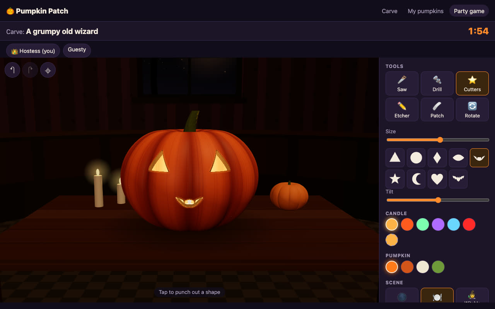
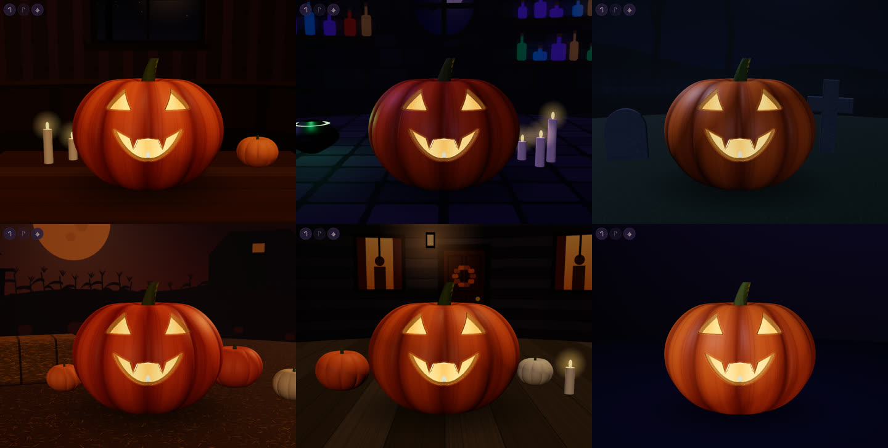

# 🎃 Pumpkin Carving Party Game

Carve a 3D jack-o-lantern in the browser, light it with any candle color, set it
in a spooky scene, and share it with a link. Or get up to 8 friends into a room,
carve the same prompt against the clock, and vote for the best one.

The app calls itself **Pumpkin Patch** in its header.



## Features

- **Real carving tools:** saw, drill, shape cutters (eyes, grins, stars, bats and
  more), an etcher that shaves the skin so it glows (pass over it again to go
  deeper, until you break through), and a patch tool to undo mistakes locally.
- **Physics-ish pieces:** anything you cut loose falls out and lands on the table.
  Undo rewinds it back into place.
- **Candle light that behaves like a candle:** light escapes only through what you
  carved, so the face is projected onto the scene around it.
- **Six scenes:** kitchen table, witch's cottage, graveyard, pumpkin patch, front
  porch and a plain studio. They're all drawn in code, so there are no image assets.
- **Save and share without accounts:** each pumpkin gets a short link with a
  preview image. Only the browser that made it can edit it, and anyone else gets
  a remix.
- **Party game:** room codes, easy-to-carve prompts ("A lazy cat") from a category
  the host picks (animals, jobs, moods, monsters, food, things, random, or the
  host's own custom list), configurable carving time (default 2 minutes) and
  votes per player (default 3), anonymous voting, results, and rematches.



## Quick start

Requires Node 20 or later (20.6+ for `--env-file`).

```bash
npm install
npm run dev      # http://localhost:3000 (API, game server and Vite hot reload)
npm test         # unit and integration tests
```

Without a `DATABASE_URL`, saved pumpkins are kept in memory and lost on restart,
which is fine for trying it out. To use Postgres locally, copy `.env.example` to
`.env`, fill it in, and run `node --env-file=.env server/index.js --dev`.

## Documentation

| Doc | What's in it |
|-----|--------------|
| [How to play](docs/how-to-play.md) | Carving tools, shortcuts, saving and sharing, running a party game |
| [Architecture](docs/architecture.md) | How carving, rendering, falling pieces and scenes work; data model; REST and WebSocket APIs |
| [Deploying](docs/deploying.md) | Supabase and Railway setup, environment variables, health checks, scaling notes |

## Stack

One small Node process does everything, which keeps hosting cheap:

- **Client:** vanilla JavaScript and [Three.js](https://threejs.org), bundled by
  Vite (about 175 KB gzipped).
- **Server:** Express 5 for the REST API and static files, plus `ws` for game rooms.
- **Database:** Postgres on Supabase through the plain `pg` driver. There's one
  table, and the server creates or migrates it on startup.

```
server/
  index.js         HTTP server, link-preview tags for /p/:id, Vite middleware in dev
  pumpkins.js      REST API for saved pumpkins
  store.js         Postgres store, or in-memory when DATABASE_URL is unset
  validate.js      payload checks shared by the API and the game
  game/rooms.js    room state machine (lobby → carving → voting → results)
  game/socket.js   WebSocket transport at /ws
  game/prompts.js  prompt word lists and picking
shared/            scene and prompt-category lists used by client and server
src/
  pumpkin/         geometry, shaders, carving mask, tools, falling pieces, scenes
  ui/workbench.js  carving UI shared by solo mode and the game
  pages/           editor (/, /edit/:id), viewer (/p/:id), /mine, /game
  game/client.js   WebSocket client with automatic reconnect
db/schema.sql      table definition (applied automatically)
railway.json       Railway build and deploy settings
.github/workflows/ keep-awake ping for the free Supabase project
test/              node:test suites
docs/              documentation and screenshots
```

## Deploying

It runs on Railway (app) and Supabase (database) for about $5 a month.
[`railway.json`](railway.json) holds the deploy settings: build, health check
at `/healthz`, app sleeping when idle, and resource caps. A GitHub Action
([`keep-awake.yml`](.github/workflows/keep-awake.yml)) pings the app every 3
days so the free Supabase project isn't paused. See
[docs/deploying.md](docs/deploying.md) for the full setup.
